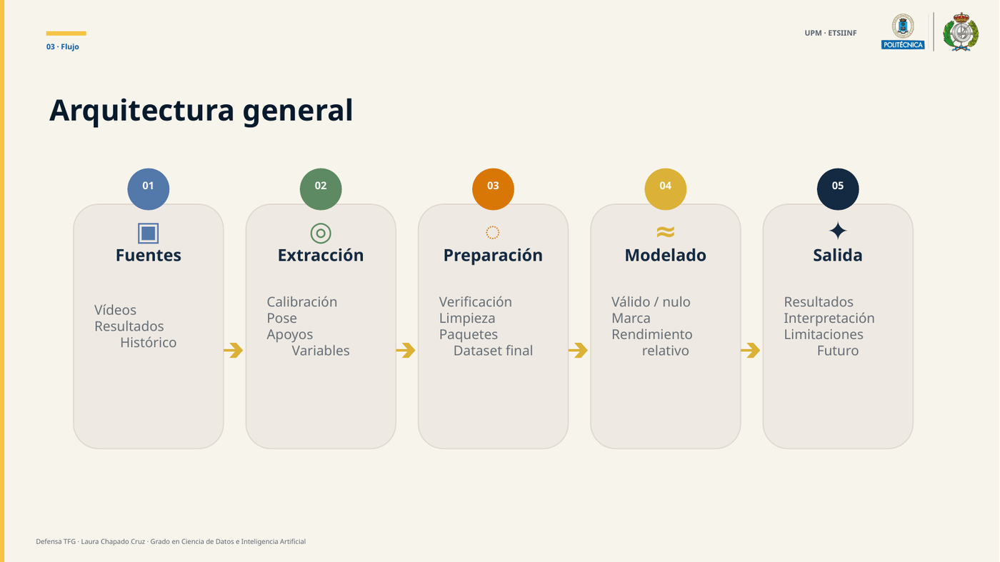
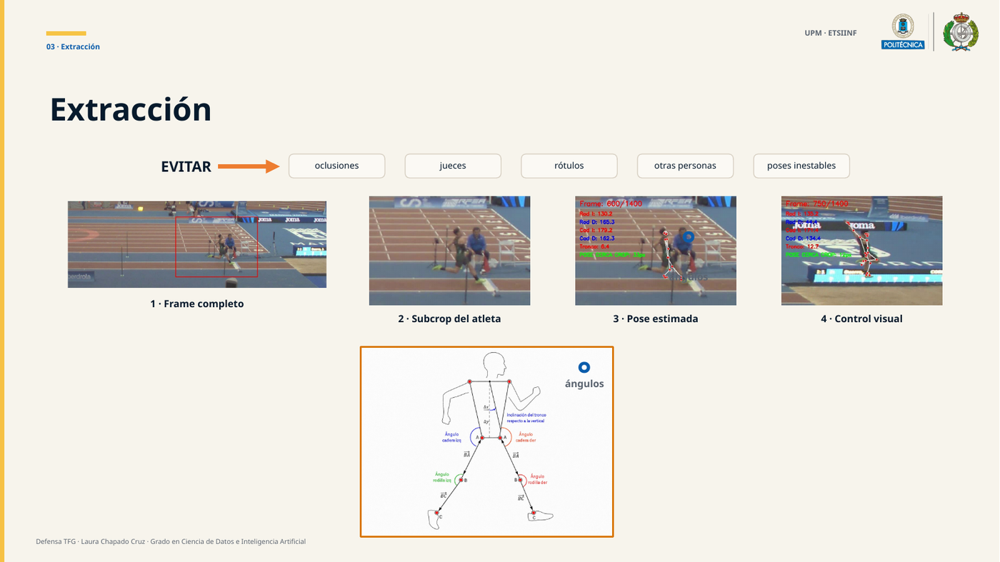
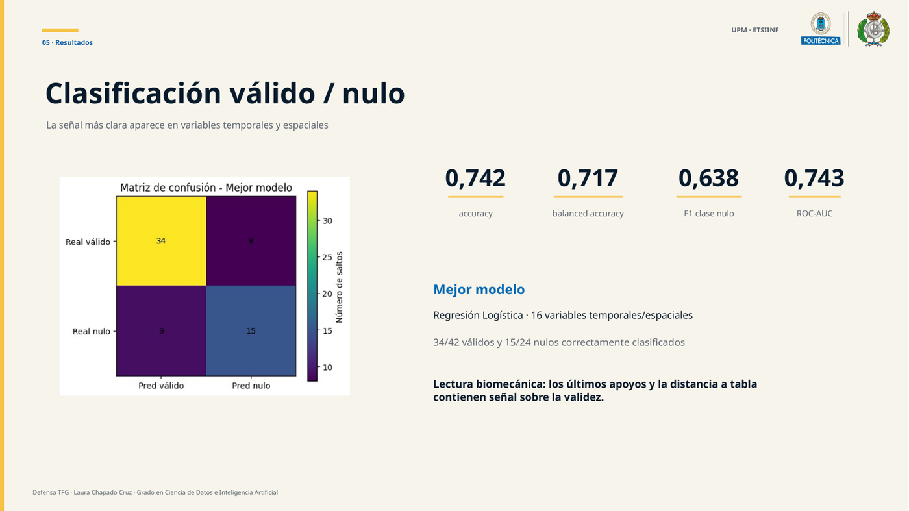
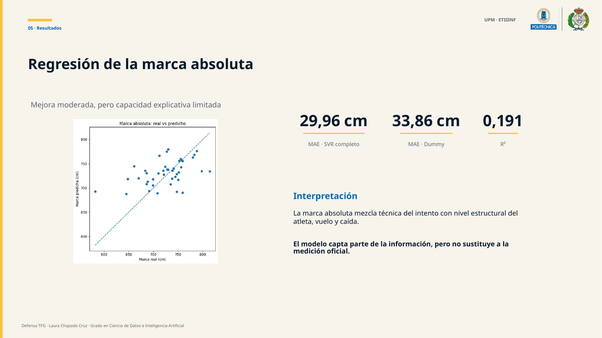
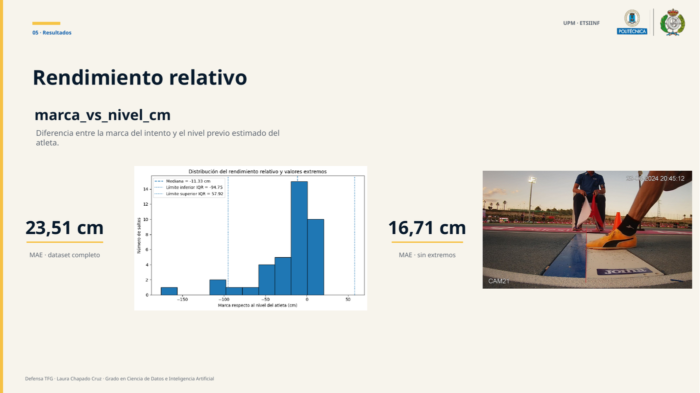

# Computer Vision & Machine Learning for Long Jump Performance

Bachelor's Thesis project for the **BSc in Data Science and Artificial Intelligence at Universidad Politécnica de Madrid (UPM)**.

The project starts from real competition video and builds an interpretable pipeline to extract biomechanical and spatiotemporal variables, construct an attempt-level dataset and evaluate whether those variables contain useful information for long-jump performance analysis.

## Study at a glance

- **66 competition attempts** from **14 athletes**
- **42 valid** and **24 foul** attempts
- lateral video recorded at **240 fps**
- computer-vision extraction of spatial, temporal, angular and velocity features
- three machine-learning tasks: valid/foul classification, absolute distance prediction and athlete-relative performance prediction

## Pipeline



The workflow combines competition video, official results and historical athlete data. The vision stage performs spatial calibration, athlete-focused cropping, pose estimation, foot-contact detection and feature extraction before the data are cleaned and modelled.



## Machine-learning tasks

### 1. Valid vs. foul classification

The strongest classification signal came from temporal and spatial variables. The best model was a logistic regression using 16 temporal/spatial features.

- Accuracy: **0.742**
- Balanced accuracy: **0.717**
- F1 score for the foul class: **0.638**
- ROC-AUC: **0.743**



### 2. Absolute jump-distance regression

The best absolute-distance model achieved a moderate improvement over the dummy baseline, but the explanatory capacity remained limited.

- SVR MAE: **29.96 cm**
- Dummy MAE: **33.86 cm**
- R²: **0.191**



### 3. Performance relative to athlete level

A contextual target was defined as the difference between the attempt result and the athlete's previous estimated performance level. Removing extreme target values reduced the mean absolute error.

- Full dataset MAE: **23.51 cm**
- MAE without extreme values: **16.71 cm**



## Repository structure

```text
.
├── src/
│   ├── extract_video_features.py
│   └── align_post_takeoff_frames.py
├── notebooks/
│   └── analysis_and_modeling.ipynb
├── data/
│   └── README.md
├── docs/
│   ├── bachelor_thesis.pdf
│   ├── REPRODUCIBILITY.md
│   └── figures/
├── outputs/
│   └── README.md
├── requirements.txt
└── README.md
```

## Main components

**`src/extract_video_features.py`**  
Processes an individual jump video: spatial calibration, automatic athlete crop, MediaPipe pose estimation, identity/quality filtering, foot-contact and take-off detection, angles and velocity-related variables.

**`src/align_post_takeoff_frames.py`**  
Selects a comparable post-take-off reference frame across attempts while accounting for temporary pose-estimation loss.

**`notebooks/analysis_and_modeling.ipynb`**  
Builds and cleans the modelling dataset, joins official results and athlete reference level, and evaluates the three modelling tasks. The notebook has been reorganised into a single execution flow and stored outputs/comments have been removed for readability.

## Technologies

**Python · OpenCV · MediaPipe · Pandas · NumPy · scikit-learn · Matplotlib · Jupyter**

## Reproducibility

The original competition videos and athlete-linked source files are not published in this repository. See [`data/README.md`](data/README.md) and [`docs/REPRODUCIBILITY.md`](docs/REPRODUCIBILITY.md) for the expected inputs and execution order.

## Author

**Laura Chapado Cruz**  
BSc Data Science & Artificial Intelligence — Universidad Politécnica de Madrid
